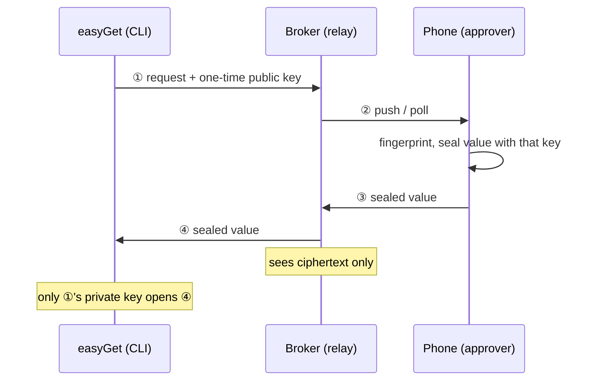

<p align="center">
  
</p>

<h1 align="center">easy-unlocker</h1>

<p align="center">
  <b>Secrets management for AI agents, approved on your phone.</b><br>
  When an agent needs an API key or credential, the plaintext never enters the conversation.<br>
  One fingerprint on a separate device, and the value arrives sealed to that one process.
</p>

<p align="center">
  <b>English</b> · <a href="README.zh-CN.md"><b>中文</b></a>
</p>

<p align="center">
  <a href="https://github.com/cyancity/easy-unlocker/releases/latest"></a>
  
  
</p>

<p align="center">
  <a href="https://easy-unlocker.pages.dev/"><b>Site</b></a> ·
  <a href="#install-and-use">Install &amp; use</a> ·
  <a href="docs/AGENTS-SETUP.md">Agent runbook</a> ·
  <a href="docs/PROTOCOL.md">Protocol</a> ·
  <a href="SECURITY.md">Security model</a>
</p>

---

## Why

Every agent eventually reaches for a secret: an API key, an SSH private key, a credential you'd rather not hand over.

The fast move is pasting it into ChatGPT or Claude. Fast, and now the plaintext lives in the model context, the transcript, and whatever logs sit downstream. The careful move is opening a password manager, copying, pasting, then double-checking the field. Nine times out of ten the chat wins, because lazy is real.

easy-unlocker makes the safe path lazier than the paste:

```bash
easyGet env OPENAI_API_KEY --exec 'python run.py' --for "calling the openai api"
# → phone pops: who (user@laptop) · what (OPENAI_API_KEY) · why
# → fingerprint → the value lands in the python process env, never on disk
```

Each `easyGet` run mints a one-time keypair. The public key rides the request to your phone, the phone seals the value with it, and only the private key held by that one command can open it. **The relay in between sees ciphertext and nothing else.** And because the approval lives on a second device, not in a window on the machine that asked, it still works when the agent runs on a server or a CI runner with no screen at all.



> Not a password manager and not a Bitwarden or 1Password replacement, no browser autofill, no subscription to buy. The vault lives on your phone and holds only the few secrets you're willing to hand to an agent.

## Install and use

Four pieces:

| Component | What it does |
|---|---|
| Phone app (`android/` `ios/`) | Stores items, approves with biometrics or password, signs SSH login certs on-device |
| `easyGet` CLI (`cli/`) | The entry point agents call: sends requests, receives sealed values, writes files or injects into processes |
| Broker (`broker/` `worker/`) | Pairing, per-vault routing, ciphertext relay. You run one yourself: a Cloudflare Worker by default (one `wrangler deploy`), or the Go binary on a VPS |
| Desktop app (`desktop/`, optional) | A second approver on Windows or macOS: approve requests, browse and copy items from a synced vault, manage devices |

**1. Install easyGet** (prebuilt for macOS / Linux / Windows):

```bash
os=$(uname -s | tr 'A-Z' 'a-z'); arch=$(uname -m | sed 's/x86_64/amd64/; s/aarch64/arm64/')
curl -L -o /tmp/easyGet "https://github.com/cyancity/easy-unlocker/releases/latest/download/easyGet-${os}-${arch}"
install -m 755 /tmp/easyGet ~/.local/bin/easyGet
```

On Windows, run [`scripts/install.ps1`](scripts/install.ps1) from a clone (it downloads `easyGet-windows-amd64.exe`, adds it to your user PATH, and can pair in the same step with `-Broker <url> -Code <code>`), or grab the exe from [Releases](https://github.com/cyancity/easy-unlocker/releases/latest).

**2. Install the app**: on Android, install `easy-unlocker-debug.apk` from Releases. On iOS, the source is in `ios/`; open it in Xcode and install with your own signing. Then create a vault (the recovery code lands in a file on the device) and point Settings at a broker.

**3. Pair**: in the app, Settings → Devices → generate a pairing code (8 characters, valid 10 minutes), then on the computer:

```bash
easyGet pair --broker https://broker.example.com --code <8-char code>
easyGet ping   # reachable, and it tells you if a newer release exists
```

> **Tip**: if pushes don't reach your Android device, check notification permission, battery policy (set to "unrestricted"), and auto-start. Many Android ROMs restrict background work by default.

**Using it** comes down to a few requests:

```bash
# most common: the value goes into a child process env, nothing touches disk
easyGet env OPENAI_API_KEY --exec 'python run.py' --for "calling the openai api"

# want a file? say so (mode 0600)
easyGet env OCI_KEY --write-to ~/.oci/key.pem --for "oci cli reads key_file"

# don't know the item names? print the names this machine has cached (no network, no prompt)
easyGet list
easyGet list --refresh   # ask the phone for the current list: one approval

# SSH login: the phone signs a cert valid for minutes, the CA key never leaves it
easyGet ssh my-ssh-ca --for "log into the server for diagnostics"
```

Works with anything that can exec a shell command: Claude Code, Codex, Cursor, Windsurf, a CI job.

> **You're an agent / coding assistant?** Install, pairing, how to pick between the request modes, and what not to do: it's all in [docs/AGENTS-SETUP.md](docs/AGENTS-SETUP.md). Follow it, and never ask a human to paste you a secret. Optional: drop [`skills/easy-unlocker/`](skills/easy-unlocker/SKILL.md) into your skills directory.

### Desktop approver (optional)

The desktop app is not in Releases yet; build it from source with Go:

```bash
cd desktop
go build -tags production -ldflags "-H windowsgui" -o easy-unlocker.exe .   # Windows
go build -tags production -o easy-unlocker .                                 # macOS
```

To pair it, enter your broker URL, click 生成配对二维码 (generate pairing QR) and scan it from the Android app's device page with 扫码配对桌面 (scan to pair desktop), or type an approver pairing code generated on the phone. The desktop UI is in Chinese for now. The phone uploads the vault as ciphertext; the desktop downloads it and unlocks it locally with your vault password or recovery code. Pairing also writes the token into the easyGet config, so the CLI on that machine works right away.

On Windows the app stays in the system tray. When a request arrives it shows a notification and brings its window to the front; once nothing is pending, it goes back to the tray.

## Features and status

### Working today

- Phone approvals: every request shows who asked, what for, and where the value lands. Approve with biometrics or password, or deny.
- Approval happens on a second device, not in a window on the requesting machine: a compromised process can't fake the prompt, and headless agents on servers or CI can still reach a human.
- Two ways to hand over: write to a 0600 file, or inject into a child process env with nothing left on disk.
- Item name list: `easyGet list` lets the agent check names before asking, instead of guessing and buzzing your phone.
- Short-lived SSH certs: the phone signs a minutes-valid login certificate with a CA key stored in the vault. The private key never leaves the phone.
- Self-serve pairing: one-time 10-minute codes or a QR scan replace manual token copying. Paired devices can be listed, revoked, renewed, renamed.
- Desktop approver: approve from your computer as well as your phone, with the vault synced as an opaque ciphertext blob the broker can't read.
- Vaults stay isolated: requests only reach the devices bound to yours. A new phone kicks the old one offline; desktop approvers paired with an approver code don't.
- Multiple brokers: pair with several gateways, switch anytime; tapping a notification jumps to the one that sent it.
- Bitwarden backup import, encrypted backup export/import (device migration), recovery code, on-device approval history.
- Push: FCM on Android, reaches the lock screen; the app polls while it's open.
- `easyGet` checks versions itself and nudges you when a newer release exists.

### Where each side stands

| Side | State |
|---|---|
| Android | Feature complete, in daily use on real devices |
| iOS | Roughly at parity with Android and tested on a real phone; missing .eu1 import, APNs push, approver pairing codes, QR pairing and vault upload |
| Desktop | Windows build tested end to end (tray, notification, approve); macOS is untested and has no tray icon; can't sign SSH certs; not in Releases yet |
| easyGet | Released for macOS, Linux, Windows |
| Broker | Two equivalent implementations (Go and Cloudflare Worker), both live |
| Landing page | Lives in its own repository (`site/` was split out) |

### Next

- iOS push: APNs needs a paid developer account; until then the iOS app polls while open
- Desktop builds in Releases, plus a macOS smoke test
- Field-level release: hand over only the fields the agent asked for from a longer note
- CLI write-back: let agents deposit newly minted credentials into the vault
- Quotas and invites for sharing one broker across users; further out, hosted subscriptions

## Security model

> **You don't have to trust the broker.** It sees metadata (item names, purpose, device names); values and CA keys travel end-to-end encrypted and it can't open them. A synced vault is stored as an opaque blob, and the recovery code and unlock password never leave your devices. Full threat model in [SECURITY.md](SECURITY.md); field-level protocol spec in [docs/PROTOCOL.md](docs/PROTOCOL.md).

## Docs

| Doc | Contents |
|---|---|
| [docs/AGENTS-SETUP.md](docs/AGENTS-SETUP.md) | Install/build/release runbook for coding assistants |
| [docs/PROTOCOL.md](docs/PROTOCOL.md) | HTTP protocol + sealed payload format + tenant model |
| [SECURITY.md](SECURITY.md) | Vulnerability reporting + threat model |
| [docs/PARITY.md](docs/PARITY.md) | Android/iOS/Desktop/Broker/CLI feature tree |
| [docs/DEPLOY.md](docs/DEPLOY.md) | Self-host the broker |

## License

| Directory | License |
|---|---|
| `cli/` `android/` `ios/` `desktop/` `internal/` `docs/` etc. | [Apache-2.0](LICENSE) |
| `broker/` `worker/` | [AGPL-3.0](broker/LICENSE): self-host freely; offer it as a hosted service and your changes must be open-sourced |
